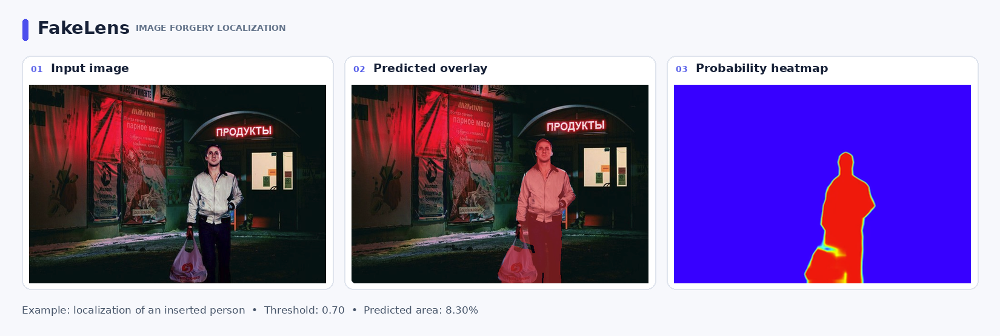

# FakeLens — Image Forgery Localization

**Author:** Nikita Nizov  
**Stack:** PyTorch · DINOv3 · Hugging Face Transformers · PEFT/LoRA · Gradio

FakeLens is a computer vision project for **pixel-level localization of image manipulations**, including copy-move and splicing forgeries. Given an image, it produces a probability map of potentially manipulated regions and a thresholded segmentation mask.

FakeLens is **not** a detector for fully AI-generated images. Its predictions are model estimates, not definitive forensic proof.

**[Try the interactive demo](https://huggingface.co/spaces/T1-Reks/fakelens)** · **[Training and evaluation notebook](FakeLens.ipynb)** · **[Model checkpoint](https://huggingface.co/spaces/T1-Reks/fakelens/blob/main/forgerylens_compact_best.pt)**

## Example Prediction



*FakeLens localizes an inserted person in a nighttime street photograph. The visualization shows the input image, predicted manipulation overlay, and probability heatmap (threshold: 0.70).*

## Results

| Dataset | Evaluation subset | Micro Dice / F1 | Micro IoU | Threshold |
|---|---|---:|---:|---:|
| CASIA v2 | Validation (2,523 images) | **0.8659** | **0.7634** | 0.5 |
| Columbia | 180 spliced + 183 authentic images | **0.9225** | **0.8562** | 0.7 |
| COVERAGE | 99 tampered + 99 authentic images | **0.7237** | **0.5670** | 0.7 |

**How to read these numbers:**

- Dice and IoU are **micro-averaged over pixels**, rather than averaged across individual images.
- The checkpoint was selected using CASIA v2 validation Dice at threshold **0.5** (0.8659). A subsequent threshold sweep on the same validation set selected **0.7**, yielding validation Dice **0.8666**. No additional training was performed during threshold selection.
- The Columbia evaluation ignores pixels with ambiguous color-coded annotations; these pixels do not contribute to TP, FP or FN.
- One COVERAGE tampered file (`46t.tif`) was absent from the available archive, so the evaluation covers **99 of 100** complete pairs.
- Columbia and COVERAGE were inspected during development. They should **not** be described as untouched blind-test datasets. Different datasets and mask-handling protocols should not be compared as though they were identical benchmarks.

## Architecture

```text
Input RGB image (512 × 512)
          │
          ▼
Pretrained DINOv3 ViT-L/16 backbone
(frozen base weights + trainable LoRA on Q/K/V)
          │
          ▼
Patch-token feature map (1024 channels)
          │
          ▼
Convolutional segmentation decoder
1024 → 256 → 64 → 1
(GroupNorm + GELU)
          │
          ▼
Bilinear upsampling → 512 × 512 logits
          │
          ▼
Sigmoid → probability map → thresholded mask
```

- **Pretrained backbone:** [`facebook/dinov3-vitl16-pretrain-lvd1689m`](https://huggingface.co/facebook/dinov3-vitl16-pretrain-lvd1689m), approximately 303.1M parameters.
- **LoRA:** rank 32, alpha 64, targeting `q_proj`, `k_proj`, and `v_proj`; 4,718,592 trainable adapter parameters.
- **Segmentation head:** two 3×3 convolutional blocks with GroupNorm and GELU, followed by a 1×1 output convolution.
- **Trainable parameters:** approximately 7.2M, including LoRA and the decoder (approximately 2.33% of the complete 310.4M-parameter model).

## Training

The model was trained on **CASIA v2**, with **7,491 authentic** and **5,123 manipulated** images successfully indexed and paired with the available ground-truth masks (**12,614 total**).

| Setting | Value |
|---|---|
| Train / validation split | 80% / 20%, stratified by image class |
| Split seed | 30 |
| Training images | 10,091 |
| Validation images | 2,523 |
| Training epochs | 5 |
| Batch size | 4 |
| Image resolution | 512 × 512 |
| Loss | BCEWithLogits + soft Dice loss |
| Optimizer | AdamW (weight decay `1e-4`) |
| LoRA learning rate | `1e-4` |
| Decoder learning rate | `1e-3` |
| Precision / environment | FP16 mixed precision, Google Colab NVIDIA T4 |

**Split limitation:** images were stratified by class but not grouped by originating source image. Related images could therefore occur on both sides of the split; this was not explicitly ruled out.

## Fast vs. tiled inference

For the high-resolution comparison, predictions were evaluated **at the original image resolution**. Fast inference resizes the full image to 512 × 512 for one forward pass, then upsamples the probability map. Tiled inference evaluates overlapping 512 × 512 patches (128-pixel overlap) and combines them with spatial weighting.

| Dataset | Method | Micro Dice / F1 | Micro IoU | Mean time (s/image) |
|---|---|---:|---:|---:|
| Columbia | **Fast** | **0.9219** | **0.8551** | **0.0875** |
| Columbia | Tiled | 0.6794 | 0.5145 | 0.5070 |
| COVERAGE | **Fast** | **0.7242** | **0.5676** | **0.0902** |
| COVERAGE | Tiled | 0.6861 | 0.5222 | 0.1596 |

Fast inference was both more accurate and faster **in these experiments** and is the default used in the demo. These figures differ slightly from the 512 × 512 evaluation above because evaluation is performed at native image resolution. The timings are measurements from the recorded experiment, not deployment latency guarantees.

## Demo and qualitative examples

The [Hugging Face Space](https://huggingface.co/spaces/T1-Reks/fakelens) provides image upload, a predicted manipulation mask, a heatmap, and adjustable threshold/overlay transparency without rerunning the model when only visualization settings change.

Its gallery includes copy-move, object insertion/replacement, authentic images, and challenging failure cases. **Gallery images illustrate model behavior; they are not an additional quantitative benchmark.**

## Notebook and model weights

The full [Colab notebook](FakeLens.ipynb) contains environment setup, backbone and LoRA initialization, dataset preparation, training, validation, threshold tuning, Columbia/COVERAGE evaluation, and fast/tiled inference comparisons. Saved plots and metrics are included, so the results can be inspected **without rerunning training**.

The [compact checkpoint](https://huggingface.co/spaces/T1-Reks/fakelens/blob/main/forgerylens_compact_best.pt) (~27.6 MiB) contains the **LoRA adapter weights and segmentation decoder weights**, plus model metadata. It **does not contain the pretrained DINOv3 backbone**. Reconstructing the model requires access to the original backbone and compatible Hugging Face Transformers/PEFT code. See the [Space source files](https://huggingface.co/spaces/T1-Reks/fakelens/tree/main) for the deployed implementation.

To inspect or rerun the notebook in Google Colab:

1. Open [`FakeLens.ipynb`](FakeLens.ipynb) in Google Colab.
2. If executing cells, use a GPU runtime and install the dependencies from `requirements.txt` / the notebook setup cells.
3. Configure a Colab Secret named `HF_TOKEN` for a Hugging Face account authorized to access the DINOv3 backbone.
4. Follow the notebook's dataset download and archive-upload steps. **Training data are not included in this repository.**

**Reproducibility note:** the published notebook preserves the original code and saved outputs, but the complete environment has not been freshly rerun from a clean runtime with pinned package versions. The notebook also contains Colab-specific paths and interactive data-upload steps; it is not a standalone one-command training pipeline.

## Limitations and responsible use

- Performance can vary with image resolution, manipulation size/type, compression, and data distribution.
- False positives on authentic photographs and missed manipulations are possible; see the demo gallery.
- The system localizes potential **regional edits**, not fully synthetic images or the truthfulness of an image's surrounding context.
- The reported results are specific to the documented dataset subsets, annotation conventions, thresholds, and evaluation resolution.
- Dataset images are **not redistributed** here. Consult the original dataset providers for usage permissions. The DINOv3 backbone is subject to [Meta's DINOv3 license](https://huggingface.co/facebook/dinov3-vitl16-pretrain-lvd1689m), not an automatically implied open-source license for the backbone or its weights.

## References

- [DINOv3 — official implementation](https://github.com/facebookresearch/dinov3)
- [DINOv3 — paper](https://arxiv.org/abs/2508.10104)
- [PEFT / LoRA](https://huggingface.co/docs/peft/index)
